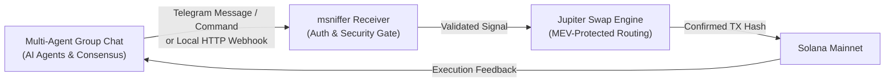

# 🐕🔎 Market Sniffer — Solana Sniper, Copy & Algorithmic AI Auto-Trader

A high-speed, institutional-grade Solana trading bot built for Telegram. Audit token contracts, mirror insider whale trades on-chain, or run autonomous algorithmic trading using real-time volume breakout & momentum pattern recognition (with zero external AI API required, plus pluggable OpenAI/Grok/Claude support).

---

## 🌟 Key Features

### 1. 🐕 Token Sniffer & Security Auditor
- **Instant Contract Sniffing:** Paste any Solana Token Contract Address (CA), pump.fun URL, or DexScreener link.
- **Honeypot & Freeze Authority Gate:** Strictly identifies tokens with active freeze authority or mint permissions.
- **Holder Distribution & RugCheck:** Verifies top 10 concentration, LP lock status, and safety risk ratings.
- **1-Tap Swap Execution:** Instant buy buttons (`0.1`, `0.25`, `0.5`, `1.0 SOL`, or custom) routed through **Jupiter Aggregator v1**.

### 2. 🎯 On-Chain Copy Trading Engine (`/copy`)
- **Universal Swap Detection:** Compares Solana `preTokenBalances` vs `postTokenBalances` on target wallets. Detects swaps across **Raydium**, **Pump.fun**, **Jupiter**, and **Orca** DEX programs.
- **Automated Mirroring:** Automatically executes matching buys and sells in real-time with sub-3-second polling.
- **Customizable Execution:** Customize copy buy size in SOL, slippage tolerance, and toggle auto-selling on/off.

### 3. ⚡ Autonomous Algorithmic & Pattern Recognition Engine (`/ai`)
- **Zero-API Key Required:** Operates 100% autonomously out-of-the-box using quantitative technical pattern recognition:
  - **Volume Acceleration Pattern:** Detects 5-minute volume surges relative to hourly moving averages.
  - **Buy Pressure Ratio:** Tracks net buyer accumulation (`buys_m5` vs `sells_m5`).
  - **Momentum & Trend Alignment:** Validates positive velocity without buying overextended parabolic tops.
  - **Safety Gate:** Filters out honeypots, active mint authorities, and high-risk contracts.
- **Strategy Profiles:**
  - **Balanced:** High-momentum breakouts with verified liquidity ($15K+) and revoked authorities.
  - **Degen:** Aggressive pump.fun curve volume scalping ($4K+ liquidity).
  - **Conservative:** Ultra-safe $50K+ liquidity with zero audit warnings.
- **Pluggable AI APIs (Optional):** Add `AI_API_KEY` for **OpenAI** (`gpt-4o-mini`), **Grok (xAI)** (`grok-beta`), or **Anthropic Claude** to get deep LLM reasoning on top of quant metrics.
- **Automated Risk Management (TP / SL):** Automatically monitors positions and executes Take Profit (`+30%`) or Stop Loss (`-15%`) exits.
- **Safety Safeguards:** 10-minute auto-buy cooldown, maximum 3 simultaneous active positions, and automatic gas balance floor protection.

### 4. 💳 Wallet Management & Phantom / Solflare Import (`/wallet`, `/import`)
- **Direct Wallet Import:** Connect an existing Phantom or Solflare wallet via Base58 private key or JSON byte array.
- **Zero Plaintext Trace:** Messages containing private keys are automatically deleted from Telegram chat history immediately upon receipt.
- **Encrypted Storage:** Keystore and settings are encrypted at rest with AES-256 Fernet (`chmod 0600`).
- **Withdraw & Export:** Easily withdraw native SOL or export keys at any time.

---

## 🛡️ Security Architecture

1. **Local AES-256 Encrypted Keystore**: Keys are encrypted at rest with AES-256 (`data/wallets.enc`, `chmod 0600`) and only decrypted in memory when signing.
2. **Private Chat Isolation**: Sensitive commands (`/wallet`, `/import`, `/alpha`) are strictly forbidden in public groups.
3. **MEV-Resistant Routing**: Dynamic compute unit limits and priority fees prevent sandwich attacks.
4. **Gas Overdraft Protection**: Preserves a minimum `0.005 SOL` safety reserve so wallets never become bricked.

---

## ⚡ Telegram Commands

| Command | Action |
| :--- | :--- |
| `/start` | Open the main dashboard with active mode badge (`🎯 Copy`, `🤖 AI`, or `⏸️ Manual`) |
| `/copy` | Open Copy Trading settings (set target wallet, copy buy size, toggle auto-sells) |
| `/ai` | Open AI / Algorithmic Autopilot settings (strategy, trade size, TP/SL targets) |
| `/import` | Securely import an existing Phantom or Solflare wallet |
| `/wallet` | View SOL & USDT balances, deposit address, withdraw funds, export key |
| `/positions` | View open token holdings with quick-sell buttons |
| `/swap` | Quick swap SOL ⇄ USDT |
| `/alpha` | Access the hidden Alpha Wallet dashboard *(admin only)* |
| `/cancel` | Cancel any pending input prompt |

---

## 🚀 Setup & Installation

### 1. Requirements
Python 3.10+ on Linux / macOS / Windows.
```bash
pip install -r requirements.txt
```

### 2. Configuration
Create `.env` based on `.env.example`:
```env
BOT_TOKEN=your_telegram_bot_token_from_botfather
RPC_ENDPOINT=https://api.mainnet-beta.solana.com
DEFAULT_SLIPPAGE_BPS=300
FEE_PERCENT=0.01

# Optional: Add external AI API key (OpenAI, Grok, Anthropic)
# If omitted, the bot runs via the built-in Algorithmic Pattern Recognition Engine
AI_PROVIDER=openai
AI_API_KEY=
AI_MODEL=
```

### 3. Run the Bot
```bash
python3 bot.py
# or
./start.sh
```

---

## 🤖 Multi-Agent AI Orchestrator Integration

`msniffer` provides an automated listener and execution interface designed to receive and execute trade consensus signals emitted by your **Multi-Agent AI Telegram Group Chat Orchestrator**.

When your AI agents debate market conditions, reach a voting consensus, and emit a buy/sell signal, `msniffer` automatically validates the payload, routes the swap through Jupiter Aggregator on Solana, and reports confirmation feedback back into the group chat.



### 1. Security & Whitelisting Configuration

Configure the following environment variables in `.env` to restrict execution exclusively to your authorized group chat and orchestrator bots:

```env
# Designated Telegram Group Chat ID where your AI bots deliberate (e.g. -1001234567890)
ORCHESTRATOR_CHAT_ID=-1001234567890

# Optional: Comma-separated Telegram User or Bot IDs allowed to trigger automated trades
ORCHESTRATOR_USER_IDS=8258083585,123456789

# Optional: Shared Secret Key for payload validation or HTTP webhook header
ORCHESTRATOR_SECRET=your_secret_consensus_token

# Optional: Local HTTP Webhook endpoint (default: http://127.0.0.1:8088)
ORCHESTRATOR_HTTP_ENABLED=true
ORCHESTRATOR_HTTP_PORT=8088
ORCHESTRATOR_HTTP_HOST=127.0.0.1
```

* **Security Gate:** Signals from unauthorized senders or outside the whitelisted group chat are strictly rejected with an audit alert.

---

### 2. Supported Signal Formats

#### Option A: Structured JSON Payload (Recommended for Multi-Agent Consensus)
The orchestrator bot can send a command (e.g. `/signal <json>`, `/execute <json>`) or post a JSON block directly into the designated group chat:

```json
{
  "action": "BUY",
  "mint": "7GCihgDB8fe6KNjn2MYtkzZcRjQy3t9GHdC8uHYmW2hr",
  "amount": 0.2,
  "symbol": "POPCAT",
  "slippage_bps": 300,
  "reason": "Consensus: 4/5 agents voted BUY due to 10x volume spike on Raydium.",
  "secret": "your_secret_consensus_token"
}
```

**SELL Example:**
```json
{
  "action": "SELL",
  "mint": "7GCihgDB8fe6KNjn2MYtkzZcRjQy3t9GHdC8uHYmW2hr",
  "amount": 100.0,
  "symbol": "POPCAT",
  "reason": "Take-profit threshold reached. Consensus: 5/5 exit."
}
```

#### Field Specifications:
| Field | Type | Required | Description |
| :--- | :--- | :--- | :--- |
| `action` | String | **Yes** | `"BUY"` or `"SELL"` |
| `mint` | String | **Yes** | Valid Solana Token Contract Address (Base58) |
| `amount` | Float | **Yes** | Amount in **SOL** (for BUY, max 1,000) or **Percentage** (for SELL, `0.1` - `100.0`) |
| `symbol` | String | *Optional* | Token ticker (e.g., `POPCAT`, `BONK`) |
| `slippage_bps`| Integer| *Optional* | Slippage tolerance in basis points (`10` to `1500`, default `300` = 3.0%) |
| `reason` | String | *Optional* | Explanation or vote tally posted back into chat feedback |
| `secret` | String | *Optional* | Shared secret if `ORCHESTRATOR_SECRET` is configured |

---

#### Option B: Compact Command Syntax
Ideal for simple bot-to-bot commands in Telegram:
```text
/signal BUY 7GCihgDB8fe6KNjn2MYtkzZcRjQy3t9GHdC8uHYmW2hr 0.25 [slippage_bps]
/signal SELL 7GCihgDB8fe6KNjn2MYtkzZcRjQy3t9GHdC8uHYmW2hr 50% [slippage_bps]
/execute BUY 7GCihgDB8fe6KNjn2MYtkzZcRjQy3t9GHdC8uHYmW2hr 0.1
!SIGNAL BUY 7GCihgDB8fe6KNjn2MYtkzZcRjQy3t9GHdC8uHYmW2hr 0.2
[AGENT_SIGNAL] ACTION=BUY MINT=7GCihgDB8fe6KNjn2MYtkzZcRjQy3t9GHdC8uHYmW2hr AMOUNT=0.2
```

---

### 3. Local HTTP Webhook Endpoint (Optional)

If your Multi-Agent Orchestrator runs locally on the same server or over a local private network, it can dispatch trades directly via HTTP POST:

```bash
# Execute Buy Order
curl -X POST http://127.0.0.1:8088/trade \
  -H "Content-Type: application/json" \
  -H "X-Orchestrator-Secret: your_secret_consensus_token" \
  -d '{
    "action": "BUY",
    "mint": "7GCihgDB8fe6KNjn2MYtkzZcRjQy3t9GHdC8uHYmW2hr",
    "amount": 0.2,
    "symbol": "POPCAT"
  }'
```

**JSON Response:**
```json
{
  "success": true,
  "action": "BUY",
  "mint": "7GCihgDB8fe6KNjn2MYtkzZcRjQy3t9GHdC8uHYmW2hr",
  "amount": 0.2,
  "symbol": "POPCAT",
  "tx_hash": "5KqX...solana_tx_hash...",
  "solscan_url": "https://solscan.io/tx/5KqX...",
  "duration_seconds": 1.42
}
```

And `msniffer` will simultaneously broadcast the execution confirmation directly into your Telegram group chat!

---

### 4. Group Chat Execution Feedback

Immediately upon receiving a signal, `msniffer`:
1. Posts an instant acknowledgement (`🤖 AI Orchestrator Signal Received! Routing swap...`).
2. Checks wallet balance and gas fee reserves (`0.005 SOL`).
3. Acquires atomic lock (`UserTradeLock`) to prevent race conditions.
4. Executes the swap via Jupiter Aggregator with priority compute units.
5. Updates the message with live execution speed (`1.42s`), direct Solscan link, received token units, and 1-tap manual exit buttons (`🔴 Sell 50%`, `🔴 Sell 100%`, `🎒 Positions`, `🔎 Resniff`).

---

## 📦 Project Structure

```
├── bot.py                   # Telegram bot UI, command handlers, and background trader loop
├── orchestrator_receiver.py # Multi-Agent AI Orchestrator receiver, parser, security & HTTP webhook
├── sniffer.py               # DexScreener market analytics, trending scanner & RugCheck auditor
├── ai_engine.py             # Algorithmic pattern recognition & pluggable LLM auto-trader
├── copy_engine.py           # On-chain target wallet swap parser & mirrored execution engine
├── wallet_manager.py        # AES-256 encrypted keystore, wallet import, transfers, and export
├── jupiter_swap.py          # Jupiter Aggregator v1 swap quotes, fee routing & transaction signing
├── config.py                # Environment variables, token constants, and storage paths
├── requirements.txt         # Python dependencies
└── start.sh                 # Service launcher script
```
